# Apartado 1  
  ## **Preparación del sistema**<br/>
   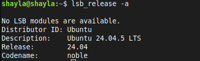
  > Comprobación de la versión del sistema </br>
  ```lsb_release -a```

# Apartado 2
  ## **Instlación de Apache**
   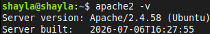
  > Comprobación de la versión instalada

 **_Pregunta: ¿Qué paquetes se han instalado como dependencias?_** <br/>
 👉 Automáticamente se nos instalan: libfwupd2 y libgusb2
 
# Apartado 3
 ## **Comprobación del sistema**
  ### _Estado del servicio_
   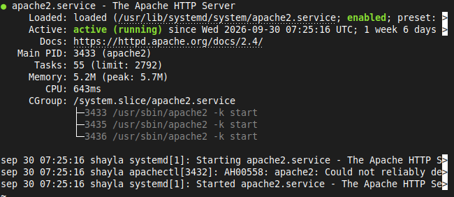
  >``sudo systemctl status apache2``

  ## _Puertos en escucha_
  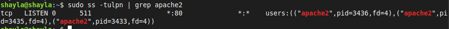
 >``sudo ss -tulpn | grep apache2``

  ## _Prueba desde el terminal y desde el navegador_
  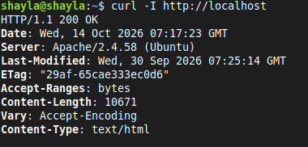
 >``curl -I http://localhost`` & Página por defecto en el navegador

  ## _Firewall_
  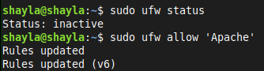
   > ``sudo ufw status``<br/>
   > ``sudo ufw allow 'Apache'``

   **_Pregunta: ¿Qué diferencia hay entre los perfiles Apache, Apache Full y Apache Secure?_** <br/>
 👉 Se diferencian por los puertos 

 # Apartado 4
 | **Comando**                           | **Función**                                     |
 |---------------------------------------|-------------------------------------------------|
 | _sudo systemctl start apache2_        |  Inicia el servicio                             | 
 | _sudo systemctl stop apache2_         |  Detiene el servicio                            |
 | _sudo systemctl restart apache2_      |  Reinicia (corta conexiones)                    | 
 | _sudo systemctl reload apache2_       |  Recarga la configuración sin cortar conexiones |
 | _sudo systemctl enable apache2_       |  Arranque automático al iniciar el sistema      |
 | _sudo systemctl disable apache2_      |  Desactiva el arranque automático               |
 | _apache2ctl configtest_               |  Comprueba la sintaxis de la configuración      |
 | _apache2ctl -s_                       |  Muestra los sitios (virtual hosts) cargados    |
 | _apache2ctl -M_                       |  Lista los módulos cargados                     |
 | _a2enmod / a2dismod_                  |  Activa / Desactiva módulos                     |
 | _a2ensite / a2dissite_                |  Activa /Desactiva sitios                       |
 | _a2enconf / a2disconf_                |  Activa / Desactiva fragmentos de configuración |

   **_Pregunta: ¿Cuándo conviene usar ***reload*** en lugar de ***restart***?_** <br/>
 👉 _Reload_ conviene usarlo cuando no queremos cortar las conexiones, es decir, mantener el servidor funcionando

# Apartado 5
  ## _Exploración de la estructura de configuración_
> ``ls -l /etc/apache2/``

 | **Ruta*                               | **Descripción**                                 |
 |---------------------------------------|-------------------------------------------------|
 | _/etc/apache2/apache2.conf_           |  En este fichero se realizan las configuraciones de apache| 
 | _/etc/apache2/ports.conf_             |  En este fichero se hacen las configuraciones de los puertos por los que Apache va a escuchar|
 | _/etc/apache2/sites-available/_       |  Aquí se almacenan todos los sitios disponibles, activos e inactivos| 
 | _/etc/apache2/sites-enabled/_         |  En este solo se muestran los sitios activos      |
 | _/etc/apache2/mods-available/ y mods-enabled/_  |  Aquí encontramos los modulos disponibles y en el segundo encontramos los habilitados|
 | /etc/apache2/conf-available/ y conf-enabled/_      |  Aquí podemos revisar la configuración disponible y en el segundo la habilitada |
 | _/etc/apache2/envvars_                |  Aquí revisamos las variables                     |
 | _/var/www/html/_                      |  Se trata del directorio raiz|
 | _/var/log/apache2/access.log_         |  Aquí se registran los accesos |
 | _/var/log/apache2/error.log_          |  Aquí se guardan los errores|

   ## _Comprobación de los enlaces simbólicos de sites-enable_
  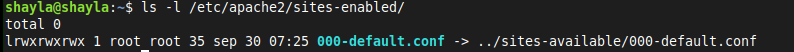
  > ``ls -l -7etc-7apache2/sites-enabled/``

   **_Pregunta: ¿Por qué Apache usa los enlaces simbólicos entre los directorios *-available y *-enabled?_** <br/>
 👉 De esta forma se evitan versiones desactualizadas  y fácilitan la la baja temporal del servicio.

# Apartado 6
  ## _Hacer copias de seguridad_
  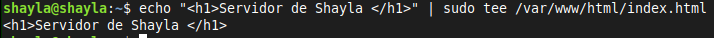
  > ``sudo cp /etc/apache2/apache2.conf /etc/apache2/apache2.conf.bak``
  ## _Cambiar la página de inicio_
  > ``echo "<h1>Servidor de TU NOMBRE </h1>" | sudo tee /var/www/html/index.html``
  
  ## _Cambiar el puerto de escucha_
  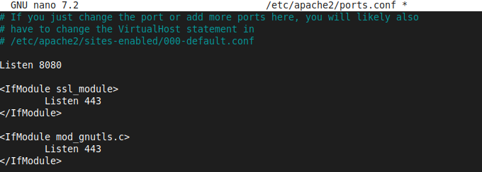
  > ``sudo nano /etc/apache2/ports.conf`` </br>
  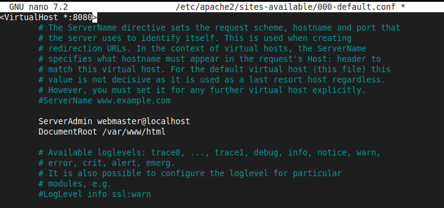
  > ``sudo nano /etc/apache2/sites-available/000-default.conf``
  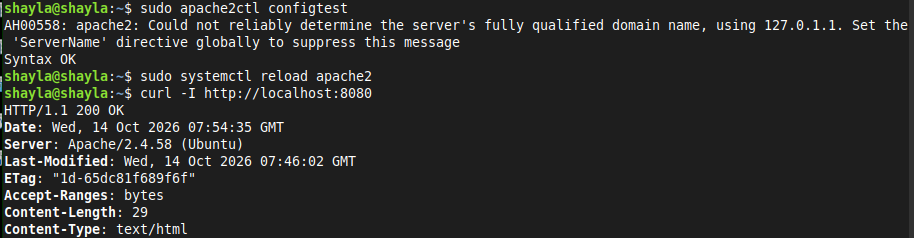
  > ``sudo apache2ctl configtest`` </br>
  > ``sudo systemctl reload apache2``
  > ``curl -I http://localhost:8080``
  ## _Definir el nombre del servidor_
  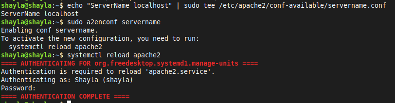
  > ``echo "ServerName localhost" | sudo tee /etc/apache2/conf-available/servername.conf`` </br>
  > ``sudo a2enconf servername``
  > ``sudo systemctl reload apache2``
  ## _Cambiar el correo del administrador_
  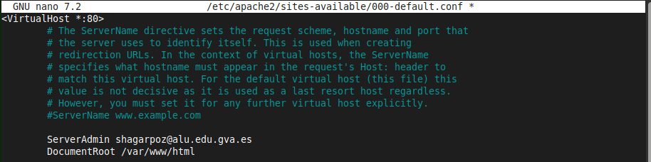
  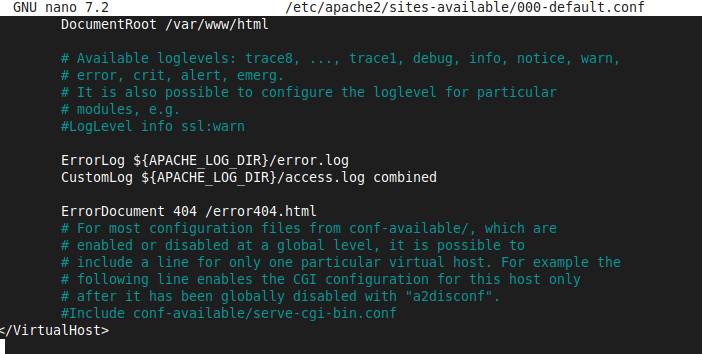

# Apartado 7
  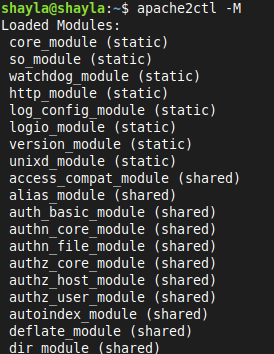
> ``apache2ctl -M`` </br>
  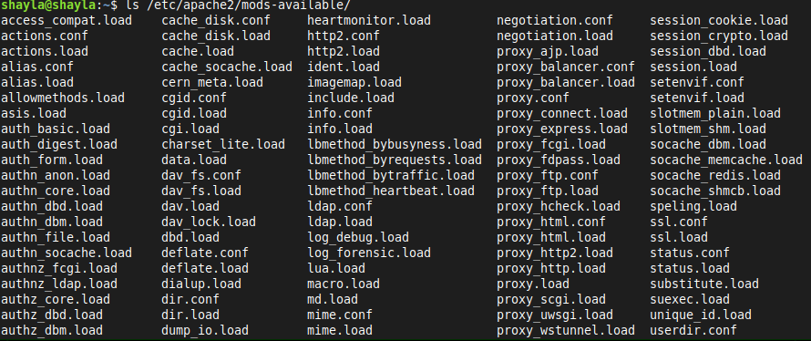
> ``ls /etc/apache2/mods-available/``

  ##  _Activa y comprueba módulos habituales_
  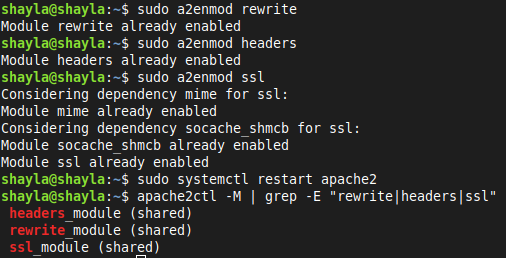
  > ``sudo a2enmod rewrite`` </br>
  > ``sudo a2enmod headers`` </br>
  > ``sudo a2enmod ssl`` </br>
  > ``sudo systemctl restart apache2`` </br>
  > ``apache2ctl -M | grep -E "rewrite|headers|ssl"``

 | **Módulo**                            | **Función**                                     |
 |---------------------------------------|-------------------------------------------------|
 | _mod_rewrite_                         |  Reescritura de URL                             | 
 | _mod_headers_                         |  Manipulación de cabeceras HTTP                 |
 | _mod ssl_                             |  Soporte HTTPS                                  | 
 | _mod_dir_                             |  Gestión de ficheros índice (index.html)        |
 | _mod_alias_                           |  Redirecciones y alias de rutas                 |
 | _mod_auth_basic_                      |  Autenticación básica                           |
 | _mod_status_                          |  Página de estado del servidor                  |
 | _mod_php / PHP-FPM_                   |  Ejecución de PHP (opcional)                    |

  ## _Desactiva un módulo y comprueba el efecto_
  
  > ``sudo a2dismod status`` </br>
  > ``sudo systemctl restart apache2``

   **_Pregunta: ¿Qué ocurre si desactivas un módulo del que depende otro?_** <br/>
 👉 El servidor fallará al iniciar o al reiniciar y mostrará un error de configuración.

# Apartado 8
> Se van a crear dos sitios: ``sitio1.local`` y ``sitio2.local``

## _Crear los directorios y páginas_
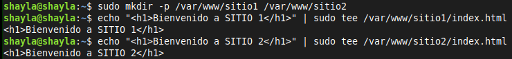
> ``sudo mkdir -p /var/www/sitio1 /var/www/sitio2`` </br>
> ``echo "<h1>Bienvenido a SITIO 1</h1>" | sudo tee /var/www/sitio1/index.html`` </br>
> ``echo "<h1>Bienvenido a SITIO 2</h1>" | sudo tee /var/www/sitio2/index.html`` </br>

## _Crear los ficheros de configuración_
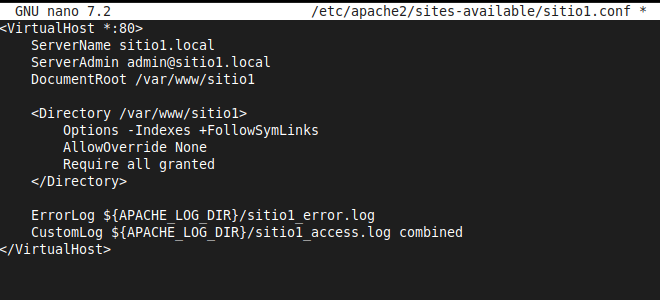
> ``sudo nano /etc/apache2/sites-available/sitio1.conf``
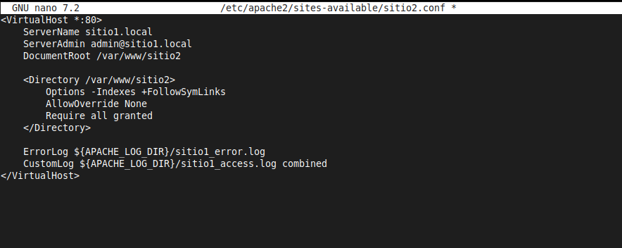
> ``sudo nano /etc/apache2/sites-available/sitio1.conf``

## _Activar los sitios y desactivar el de por defecto_
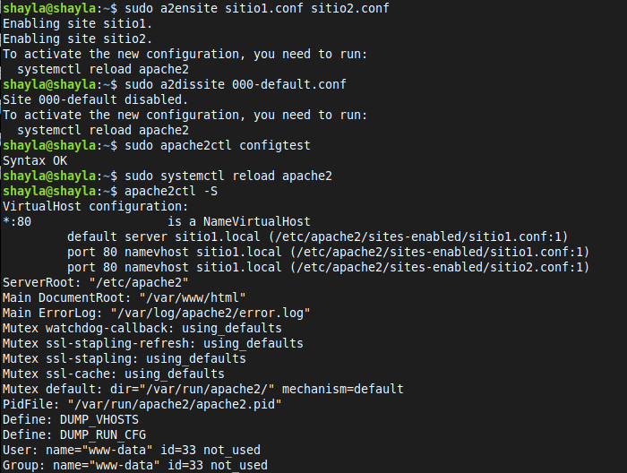
> `` sudo a2ensite sitio1.conf sitio2.conf`` </br>
> ``sudo a2dissite 000-default.conf`` </br>
> ``sudo apache2ctl configtest`` </br>
> ``sudo systemctl reload apache2`` </br>
> ``apache2ctl -S``
