# Apartado 1  
  ## **Preparación del sistema**<br/>
   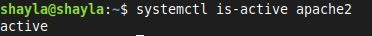
  > Comprobación de la versión de Apache</br>
  ```system is-active apache2```

# Apartado 2
  ## **Instalación de MariaBD y su comprobación**
  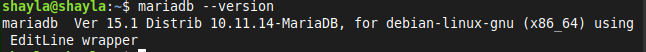
  > Comprobación de la versión </br>
  > ``mariadb --version``

# Apartado 3
  ## **Estado del servicio**
   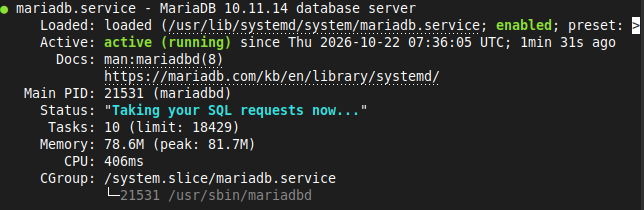
  > ``sudo systenctl status mariadb``
   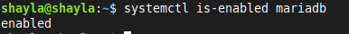
  >``systemctl is-enable mariadb``
  ## **Entrar en la base de datos**
   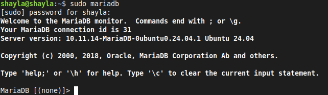
   > ``sudo mariadb``

# Apartado 4
 | **Comando**                           | **Función**                                     |
 |---------------------------------------|-------------------------------------------------|
 | _sudo systemctl start mariadb_        |  Inicia el servicio                             | 
 | _sudo systemctl stop mariadb_         |  Detiene el servicio                            |
 | _sudo systemctl restart mariadb_      |  Reinicia                                       | 
 | _sudo systemctl status mariadb_       |  Recarga la configuración sin cortar conexiones |
 | _sudo systemctl enable apache2_       |  Arranque automático al iniciar el sistema      |

# Apartado 5
  ## **Error al parar MariaDB**
  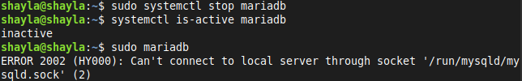
     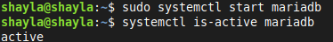 </br>
 **_Pregunta:  Si WordPress no pudiera conectar con la base de datos, ¿qué dos comandos de este apartado usarías
para saber si el problema es que MariaDB está parado?_** <br/>
 👉 Systemctl is-active mariabd

 # Apartado 7 
 ## **Instalación de PHP y las piezas que WordPress necesita**
   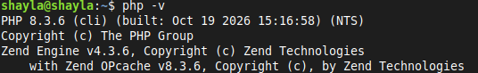
  ## **Comprobación PHP**
   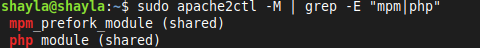
  ## **Comprobación conexión MariaDB**
   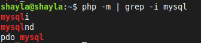
  ## **Comprobación de que Apache ejecuta PHP**
  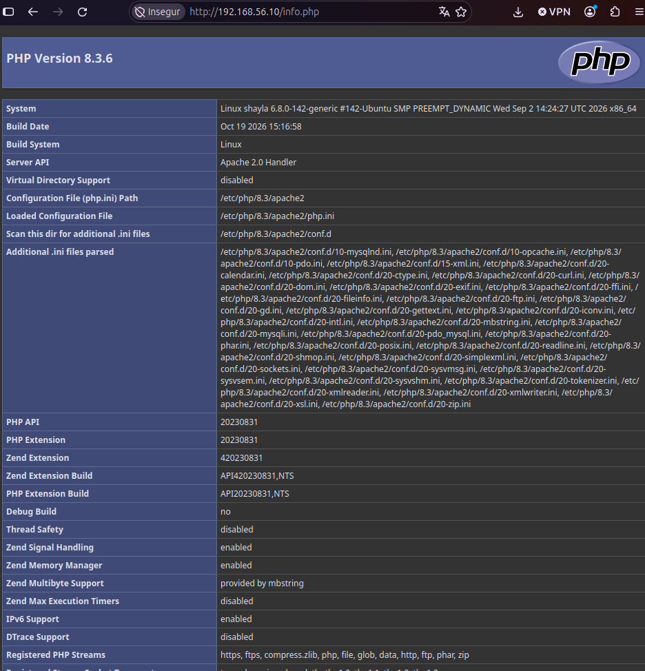

   **_Pregunta:  ¿Por qué es peligroso dejar info.php en un servidor real? ¿Para qué sirve el paquete php-mysql? ?_** <br/>
 👉 Estarías dando los datos necesarios para un acceso indeseado.
