# Apartado 1
  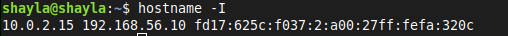
> ``hostname -I`` </br>

  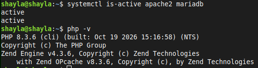
> ``systemctl is-active apache2 mariadb``
> ``php -v`` </br>

 **_Pregunta: ¿Qué dos "puertas" (programas y puertos) usas para trabajar con el servidor en esta práctica y para qué sirve cada una?_** <br/>
 👉 SSH con puerto 22

# Apartado 2
 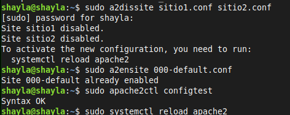
 > ```sudo a2dissite sitio1.conf sitio2.conf```
 >```sudo a2ensite 000-default.conf```
 > ```sudo apache2ctl configtest```
 > ```sudo systemctl reload apache2``` </br>
 
  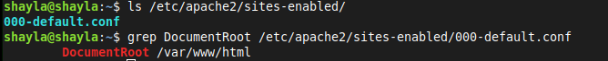
> ``ls /etc/apache2/sites-enabled/``
> ``grep DocumentRoot /etc/apache2/sites-enabled/000-default.conf``</br>

  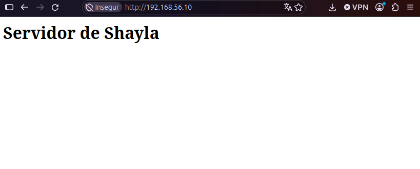

 **_Pregunta: ¿Qué diferencia hay entre desactivar un sitio con a2issite y borrar sus ficheros? ¿Por qué ahora ves la página por defecto de Apache y antes veías sitio1?_** <br/>
 👉 Si borro los ficheros no podré volver a utilizarlos mientras que si los desactivo se quedan guardados para poder usarse. Respecto a la página de defecto Apache la veo porque no tiene página establecida

 # Apartado 3
 
  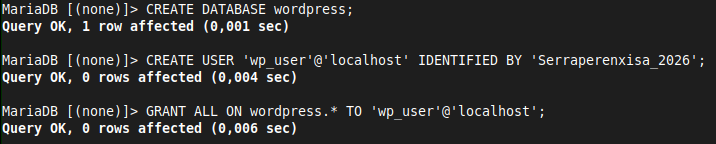
  > ``CREATE DATABASE wordpress;`` </br>
  > ``CREATE USER 'wp_user'@'localhost' IDENTIFIED BY 'ClaveSegura_2026';``</br>
  > ```GRANT ALL ON wordpress.* TO 'wp_user'@'localhost';```

  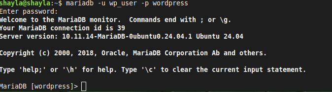
  > Comprobación de la máquina </br>
  >``mariadb -u wp_user -p wordpress``

 **_Pregunta: ¿Por qué crees que WordPress usa su propio usuario wp_user con permiso solo sobre su base y no el usuario root de MariaDB?_** <br/>
 👉 Por qué si el usuario root fuese el usuario principal podría llegar a modificar distintas bases sin darse cuenta. 

 # Apartado 4
  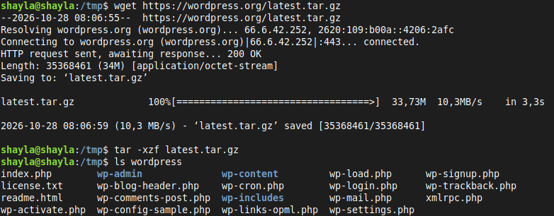
 **_Pregunta: Explica que ace cada uno de los comandos que acabas de ejecutar_** <br/>
 👉 rm borra index, con copiamos wordpress en var, con rm -r borramos wordpress y latest.tar.gz

  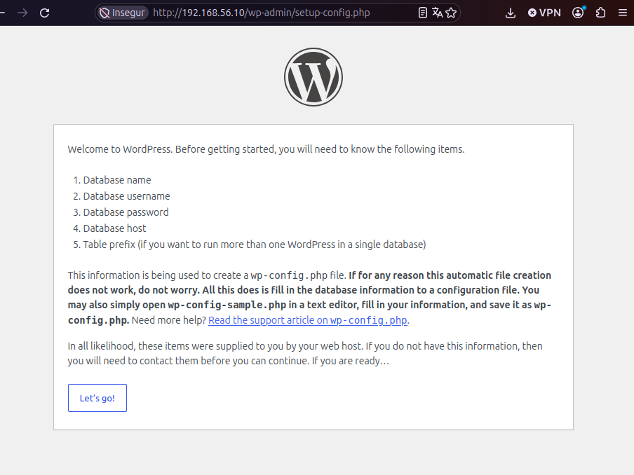
   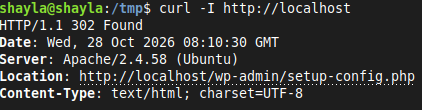  
   > PRUEBA

   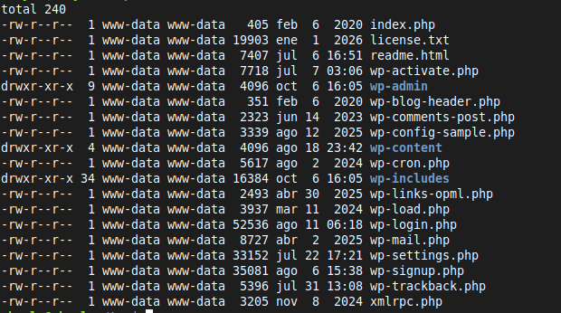  
   > Permisos

 **_Pregunta:  Explica qué hace cada una de las órdenes que has ejecutado. ¿Por qué hay que cambiar el propietario de la carpeta de WordPress a www-data? ¿Qué podría fallar si siguiera siendo tu usuario?_** <br/>
 👉 Si siguiese siendo mi usuario tendría problemas con los permisos y las modificaciones.

 # Apartado 5
  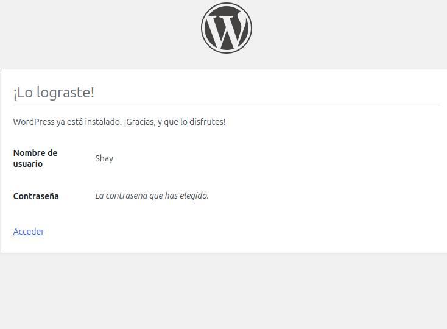  
  > Datos introducidos con exito <br>

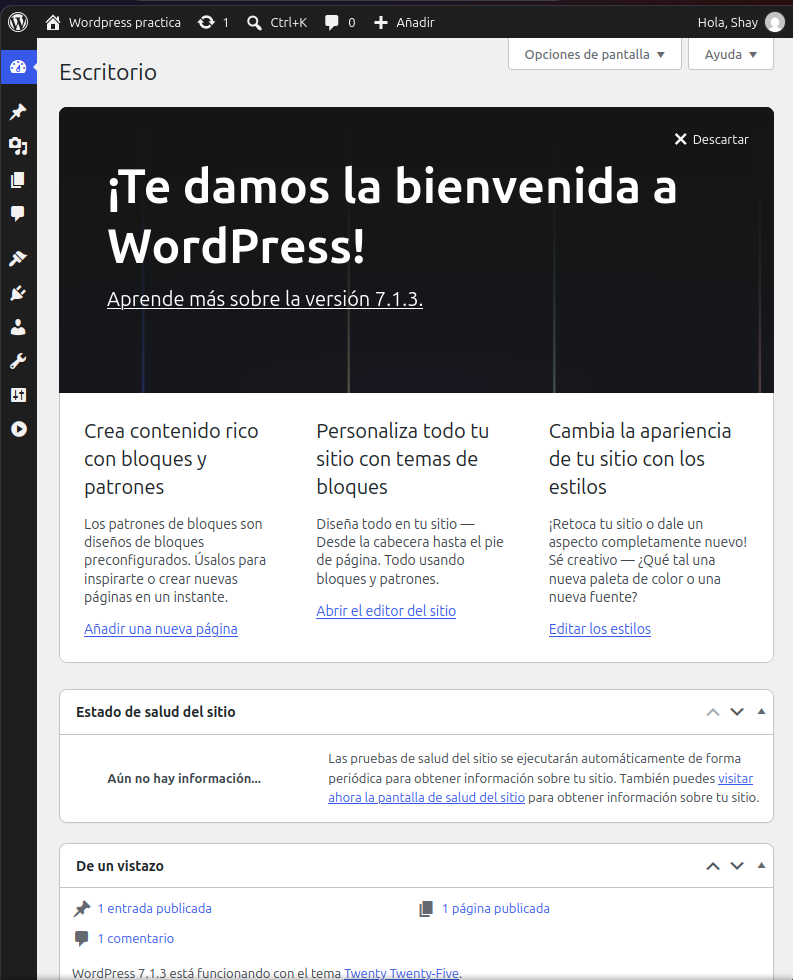  
> Página inicial Wordpress

# Apartado 6
   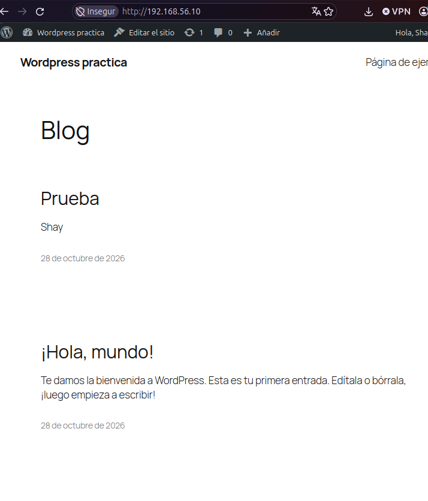  
   > Página publicada </br>
   
   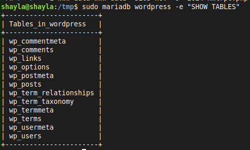
  > ```sudo mariadb wordpress -e "SHOW TABLES;"```

  # Apartado 7 
   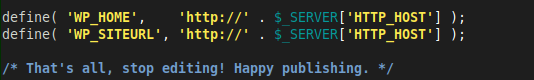
   >```define( 'WP_HOME',    'http://' . $_SERVER['HTTP_HOST'] );```
    > ``define( 'WP_SITEURL', 'http://' . $_SERVER['HTTP_HOST'] );``

   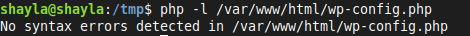
   >``php -l /var/www/html/wp-config.php``

  # Apartado 8

   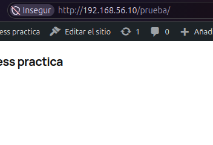
   > Ponemos urls bonitas

   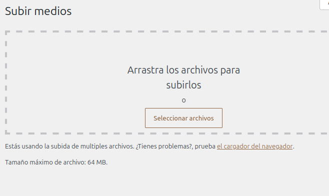
   > Cambiamos el máximo del tamaño permitido de subida


 **_Pregunta:  ¿Por qué las direcciones "bonitas" dan error 404 si Apache no tiene permitido leer el fichero .htaccess?_** <br/>
 👉 Porque no puede crear rutas

 # Apartado 9
  
   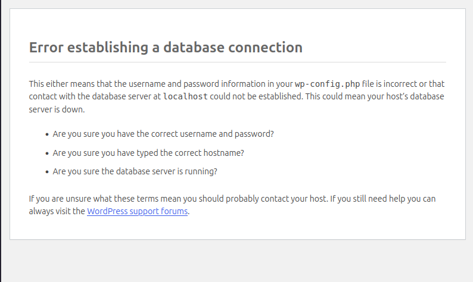
   > ERROR


   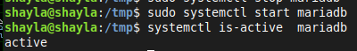
   > Resolución

# Apartado 10

   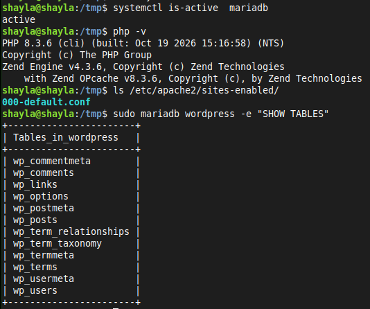
  > Comprobación final
